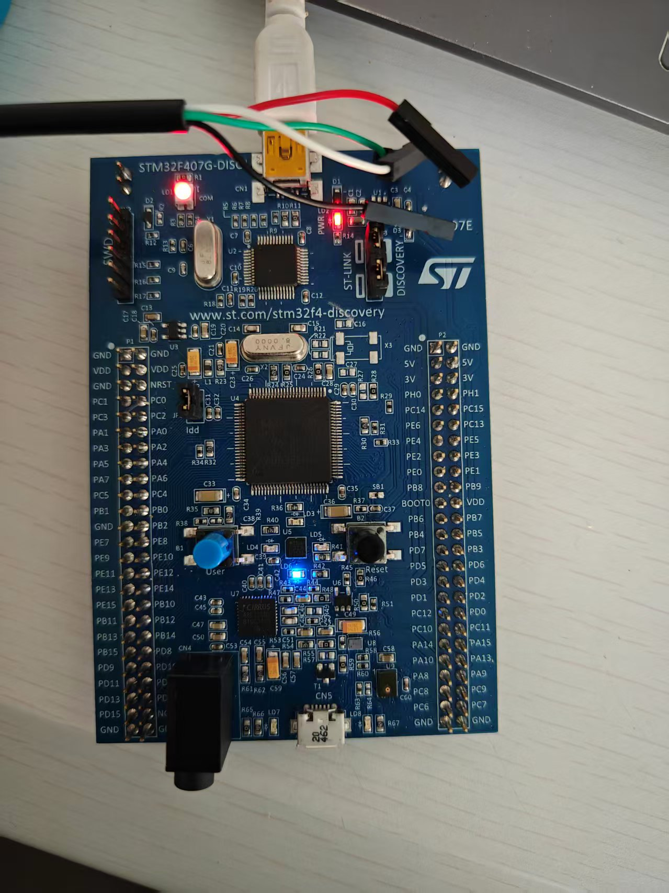
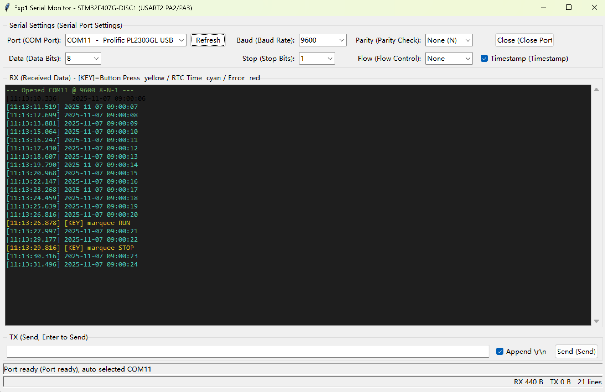

# 实验一：总线/接口驱动开发技术、GPIO 接口驱动程序设计

> 课程：微处理器结构与嵌入式系统设计
> 硬件：STM32F407G-DISC1（STM32F407VGT6，LQFP100，8 MHz 晶振）
> 工具：STM32CubeMX 6.15.0 + Keil MDK 5.29（ARMCC 5.06）+ STM32Cube FW_F4 V1.28.0

本工程由 **CubeMX 生成的外设初始化代码 + 用户应用代码** 组成，已用 Keil 命令行
编译验证通过（0 Error / 0 Warning），`MDK-ARM/Objects/` 下有可直接下载的
`Exp1_GPIO_UART_RTC.hex`。

## 实际运行效果

**硬件连线与烧录后运行**（USB 转 TTL 模块接 PA2/PA3，板载 LED 跑马灯）：



**LED3~LED6 跑马灯实拍**（B1 按键启停，200 ms 正转逐一点亮，点击播放）：

▶ [`docs/media/marquee_demo.mp4`](docs/media/marquee_demo.mp4)

**串口监测 GUI 实测**（RTC 时间逐秒上传 + 按键事件打印）：



上图中：青色行为 RTC 秒中断上传的时间；黄色 `[KEY] marquee RUN/STOP`
为按键启停事件；波特率 9600-8-N-1。

---

## 一、实验要求与本工程实现对照

| 实验要求 | 实现位置 | 实现方式 |
|---|---|---|
| 系统时钟配置为 168 MHz | `Core/Src/main.c` → `SystemClock_Config()` | HSE 8 MHz → PLL(M=8,N=336,P=2)，AHB/1、APB1/4、APB2/2，Flash 5 WS |
| 按键输入控制 LED3~LED6 正转逐一点亮 | `main.c` → `Key_Scan()` / `Led_Marquee_Step()` | B1(PA0) 扫描 + 20 ms 消抖；按一次启动/停止；运行中每 200 ms 正转点亮点亮 LED3→LED4→LED5→LED6 |
| 串口 9600、1 停止位、8 数据位 | `Core/Src/usart.c` → `MX_USART2_UART_Init()` | USART2：9600-8-N-1，无硬件流控，PA2=TX、PA3=RX |
| 秒信号中断中把 RTC 时间转成字符串经串口发送 | `Core/Src/rtc.c` + `Core/Src/stm32f4xx_it.c` | RTC 时钟源 LSI，WakeUp Timer 1 Hz 中断；中断内读时间→`snprintf` 格式化→置标志，主循环发送 |

附加（对应任务书“串行数据传输测试”）：串口接收中断 + 逐字节回显，在串口助手中
发送任意字符即可收到相同字符。

---

## 二、目录结构

```
Exp1_GPIO_UART_RTC/
├─ Exp1_GPIO_UART_RTC.ioc        CubeMX 工程配置（时钟树/引脚/外设）
├─ Core/
│  ├─ Inc/  main.h  gpio.h  usart.h  rtc.h  stm32f4xx_it.h  stm32f4xx_hal_conf.h
│  └─ Src/  main.c  gpio.c  usart.c  rtc.c  stm32f4xx_hal_msp.c
│           stm32f4xx_it.c  system_stm32f4xx.c
├─ Drivers/                      CMSIS + STM32F4xx HAL（CubeF4 V1.28.0）
└─ MDK-ARM/
   ├─ Exp1_GPIO_UART_RTC.uvprojx Keil 工程（AC5，标准库，无半主机）
   ├─ startup_stm32f407xx.s
   └─ Objects/                   编译输出：.axf / .hex / .htm(占用)
```

---

## 三、系统时钟（168 MHz）推导

| 项目 | 参数 | 结果 |
|---|---|---|
| 时钟源 | HSE 外部晶振 | 8 MHz |
| PLL 输入分频 | PLLM = 8 | 1 MHz（VCO 输入，需 1~2 MHz） |
| PLL 倍频 | PLLN = 336 | 336 MHz（VCO 输出） |
| PLL 系统分频 | PLLP = 2 | **SYSCLK = 168 MHz** |
| PLL 48 MHz 分频 | PLLQ = 7 | 48 MHz（USB/SDIO） |
| AHB 分频 | /1 | HCLK = 168 MHz |
| APB1 分频 | /4 | PCLK1 = 42 MHz（上限 42 MHz） |
| APB2 分频 | /2 | PCLK2 = 84 MHz（上限 84 MHz） |
| Flash 等待周期 | 5 WS | 168 MHz @ 3.3 V、Scale1 必须 |

要点：168 MHz 必须先把调压器设为 **Scale 1**（`__HAL_PWR_VOLTAGESCALING_CONFIG`），
并把 Flash 等待周期设为 5；这两件事 `HAL_RCC_ClockConfig()` 会按 HCLK 自动处理，
但电压等级需要在调用前手动设置。

---

## 四、引脚与外设配置

| 引脚 | 功能 | 配置 |
|---|---|---|
| PD13 | LD3 橙色 LED | 推挽输出，低速，初始低 |
| PD12 | LD4 绿色 LED | 推挽输出，低速，初始低 |
| PD14 | LD5 红色 LED | 推挽输出，低速，初始低 |
| PD15 | LD6 蓝色 LED | 推挽输出，低速，初始低 |
| PA0 | B1 用户按键 | 输入 + **下拉**（按下为高电平） |
| PA2 | USART2_TX | 复用 AF7，推挽，上拉，Very High |
| PA3 | USART2_RX | 复用 AF7，推挽，上拉，Very High |
| PE4 | 串口“地”参考 | 推挽输出低电平 |
| PH0/PH1 | HSE 晶振 | RCC_OSC_IN / RCC_OSC_OUT |
| PA13/PA14 | SWD 调试 | SYS_JTMS-SWDIO / SYS_JTCK-SWCLK |

中断：USART2 抢占优先级 1；RTC_WKUP 抢占优先级 0（时间基准优先）。
RTC 时钟源：**LSI**（板上未焊 32.768 kHz 晶振，不能选 LSE）。

> 说明：任务书/课件要求把 PE4 配成输出低电平当串口线地参考，本工程已按此配置；
> 实际接线时优先使用板上 GND 排针，PE4 只是就近取地的备用方案。

---

## 五、程序流程

```
main()
 ├─ HAL_Init()                     1 ms SysTick 时基
 ├─ SystemClock_Config()           HSE→PLL→168 MHz
 ├─ MX_GPIO_Init()                 LED 输出 / 按键下拉输入 / PE4 低
 ├─ MX_RTC_Init()                  LSI + 分频(127/249)=1 Hz，写初始时间，
 │                                 启动 WakeUp Timer（1 s）并开 RTC_WKUP 中断
 ├─ MX_USART2_UART_Init()          9600-8-N-1，开接收中断
 └─ while(1)
     ├─ Key_Scan()                 消抖；按下沿切换 运行/停止，并 printf("[KEY] ...")
     ├─ 每 200 ms：Led_Marquee_Step()   LED3→LED4→LED5→LED6 正转
     └─ g_rtcSecFlag==1 → HAL_UART_Transmit(时间字符串)

RTC_WKUP_IRQHandler (1 Hz)
 └─ HAL_RTCEx_WakeUpTimerIRQHandler()
     └─ HAL_RTCEx_WakeUpTimerEventCallback()
         ├─ HAL_RTC_GetTime() / GetDate()（先时间后日期）
         ├─ m_nRtcYMD / m_nRtcHMS 换算
         ├─ snprintf → g_rtcString "2025-11-07 09:00:01\r\n"
         └─ g_rtcSecFlag = 1

USART2_IRQHandler
 └─ HAL_UART_IRQHandler()
     └─ HAL_UART_RxCpltCallback()  收到 1 字节 → 原样回发 → 重新开接收
```

设计说明：秒中断里只做“读时间 + 格式化 + 置标志”，真正的串口发送放在主循环。
9600 bps 下发送 22 字节约需 23 ms，若在中断里直接发送会长时间占用中断，
影响按键扫描和串口接收；分离后既满足“秒中断响应，串口上传”的要求，也更稳。

---

## 六、编译与下载

1. **打开工程**：Keil uVision5 → `Project → Open Project` →
   `MDK-ARM/Exp1_GPIO_UART_RTC.uvprojx`（工程路径不要含中文）。
2. **编译**：`F7`（Build），应显示 `0 Error(s), 0 Warning(s)`。
3. **下载**：板载 ST-LINK（USB 口标着 ST-LINK）连电脑，安装 ST-LINK 驱动后
   `F8`（Download）。若提示找不到器件：`Options for Target → Debug` 选
   `ST-Link Debugger`，`Settings → Flash Download` 勾选 `Reset and Run`。
   （备选：把 `MDK-ARM/Objects/Exp1_GPIO_UART_RTC.bin` 拖到 `DIS_F407VG` 盘即可烧录）
4. 也可用 STM32CubeProgrammer / ST-LINK Utility 直接下载
   `MDK-ARM/Objects/Exp1_GPIO_UART_RTC.hex`。

### 串口监测工具（tools\ 目录）

| 文件 | 用途 |
|---|---|
| `serial_monitor_gui.bat` | **双击启动 GUI 版**：窗口内可选 COM 口、波特率（1200~921600）、数据位、奇偶校验（None/Even/Odd/Mark/Space）、停止位、流控；实时彩色显示 RX（KEY 黄 / RTC 青 / 错误红）、毫秒时间戳、TX 发送框、RX/TX 字节统计；`-p COM11 -o` 可指定端口并自动打开 |
| `serial_monitor.bat` | 命令行版：交互收发，Ctrl+C 退出 |
| `serial_monitor.py` / `serial_monitor_gui.py` | 对应源码 |
| `logs\` | 每次运行自动保存收发日志，报告可直接引用 |

注意：`COM11` 一次只能被一个程序占用，GUI 与命令行版不要同时开；
GUI 启动时自动跳过 ST-Link 虚拟串口（COM10，未接 PA2/PA3）。

---

## 七、串口接线与测试

**接线**（USB 转 TTL 模块 ↔ 开发板，模块的 VCC/红线不接）：

| USB 转串口模块 | 开发板 |
|---|---|
| RXD | PA2（USART2_TX） |
| TXD | PA3（USART2_RX） |
| GND | GND（或 PE4） |

**串口调试助手设置**：波特率 9600、数据位 8、停止位 1、无校验、无流控。

**上电后的预期输出**：

```
**********************************************
*  STM32F407G-DISC1  Experiment 1            *
*  Clock / GPIO / UART2 / RTC                *
**********************************************
SYSCLK = 168000000 Hz
HCLK   = 168000000 Hz
PCLK1  = 42000000 Hz (APB1, max 42 MHz)
PCLK2  = 84000000 Hz (APB2, max 84 MHz)
USART2 : 9600 bps, 8 data bits, 1 stop bit, no parity
Press B1 (PA0) to START/STOP the LED marquee (LED3->LED6)

2025-11-07 09:00:01
2025-11-07 09:00:02
...
```

**测试步骤与判据**

| # | 操作 | 预期现象 | 说明 |
|---|---|---|---|
| 1 | 上电/复位 | 串口打印版本信息和 168 MHz 时钟频率 | 证明时钟树配置正确 |
| 2 | 观察串口 | 每秒一行时间，秒数连续递增 | 证明 RTC 秒中断正常 |
| 3 | 按一下 B1 | 4 个 LED 依次点亮循环（LED3→LED6，每 200 ms 一步），串口打印 `[KEY] marquee RUN` | GPIO 输出 + 按键扫描 |
| 4 | 再按一下 B1 | LED 全灭，串口打印 `[KEY] marquee STOP` | 按键状态切换 |
| 5 | 串口助手发送任意字符 | 立即回显相同字符 | USART 收发通路正常 |
| 6 | 万用表/示波器 | PA2 空闲为高，发送时可见 9600 bps 波形；PD12~PD15 交替出现 3.3 V | 可选，硬件联调 |

记录测试结果时建议截图：Keil 编译结果、串口助手的时钟频率与逐秒时间、
按键时的 `[KEY]` 打印、LED 点亮状态照片。

### 实测记录（已在本机台架上验证）

固件通过板载 DAPLink（卷标 `DIS_F407VG`）拖拽烧录后，用 SWD 读取芯片寄存器核对：

| 检查项 | 读回值 | 结论 |
|---|---|---|
| `RCC_PLLCFGR` | `0x07405408` → M=8, N=336, P=2, Q=7, src=HSE | PLL 按设计锁定 |
| `RCC_CFGR` | `0x0000940A` → SWS=2(PLL), HPRE=/1, PPRE1=/4, PPRE2=/2 | HCLK 168 / PCLK1 42 / PCLK2 84 MHz |
| `RTC_DR` / `RTC_TR` | `0x0025B107` / `0x00090001` | 2025-11-07 09:00:01 |
| `g_rtcString`（RAM） | `2025-11-07 09:00:01` → `2025-11-07 09:00:02` | 秒中断逐秒更新，格式化正确 |
| `m_nRtcYMD` / `m_nRtcHMS` | `251107` / `90001`→`90002` | 年月日/时分秒换算正确 |
| `USART2` CR1/CR2/BRR | `0x202C` / `0x0000` / `0x1117` | UE=TE=RE=1；8 位、无校验、1 停止位；BRR 对应 9600 bps |
| `USART2` SR | `TC=1, TXE=1` | 发送完成 |
| `GPIOD` MODER/ODR | PD12~15 均为输出，ODR 全 0 | LED 初始熄灭 |

> 说明：板载 ST-LINK 的虚拟串口（COM10）并未连接到 PA2/PA3，所以串口数据必须用
> 外部 USB 转 TTL 模块读取（与实验指导书一致）。上表中寄存器读数已证明 USART2
> 配置正确且发送完成，只是“数据没接到 ST-LINK 的 VCP 上”。

---

## 八、关键代码说明

- **printf 重定向**（`main.c`）：AC5 标准库默认走半主机（semihosting），脱机运行会
  卡死。工程用 `#pragma import(__use_no_semihosting)` + `_sys_exit` / `_ttywrch`
  桩函数，并实现 `fputc` 把字符送到 USART2；因此**不依赖 MicroLIB**，用 CubeMX
  重新生成代码也不会失效。
- **按键消抖**（`Key_Scan`）：记录上次电平，电平变化且距上次变化 ≥ 20 ms 才认账，
  只对“按下沿”动作，避免一次按键触发多次。
- **RTC 时基**：LSI≈32 kHz → 异步分频 128（`AsynchPrediv=127`）得 250 Hz →
  同步分频 250（`SynchPrediv=249`）得 1 Hz 计数时钟；WakeUp Timer 用
  `RTC_WAKEUPCLOCK_CK_SPRE_16BITS`、计数值 0，即每 1 s 中断一次。
- **读 RTC 的顺序**：必须先 `HAL_RTC_GetTime()` 再 `HAL_RTC_GetDate()`，
  读日期会解锁影子寄存器，否则读到的值可能不更新。
- **串口错误恢复**：`HAL_UART_ErrorCallback` 里清 ORE 并重新开启接收，
  防止长时间运行后因溢出“失联”。

---

## 九、常见问题

| 现象 | 原因 / 处理 |
|---|---|
| Keil 编译报找不到头文件 | 工程路径含中文或空格；把整个目录移到纯英文路径（如 `D:\EmbeddedLab\Projects\`） |
| 串口无任何输出 | ①TX/RX 未交叉 ②GND 未共地 ③波特率不是 9600 ④PE4 当地时未接好 |
| 输出乱码 | 波特率/校验位不一致；确认 8-N-1、9600 |
| LED 不亮 | 确认下载成功（`Reset and Run`）；LED 为高电平点亮，PD12~PD15 |
| 时间每秒跳 2 秒或变慢 | LSI 精度差（±1% 以上），属正常；对精度有要求应焊 LSE 32.768 kHz 晶振后改用 LSE |
| 用 CubeMX 重新生成后 printf 无输出 | 本工程已用“无半主机”方案规避；若仍异常，检查 `main.c` 的 USER CODE 0 段是否被删 |
| 下载报 “No Cortex-M device found” | ST-LINK 驱动未装或 USB 线只供电；换线、重装驱动 |

---

## 十、用 CubeMX 复现/查看配置

双击 `Exp1_GPIO_UART_RTC.ioc` 打开，可直接看到：

- **Pinout & Configuration**：USART2（Asynchronous, 9600）、RTC（LSI）、GPIO 引脚；
- **Clock Configuration**：HSE 8 MHz、PLLM 8 / PLLN 336 / PLLP 2 / PLLQ 7、
  HCLK 168 MHz、APB1 42 MHz、APB2 84 MHz；
- **Project Manager**：MDK-ARM V5.32、每外设生成独立 .c/.h（与本工程结构一致）。

注意两点：

1. CubeMX 的 RTC 面板里 **WakeUp Timer 的使能**在 6.15 的 `.ioc` 中没有对应开关，
   本工程在 `rtc.c` 的 `MX_RTC_Init()`（USER CODE 段）里调用
   `HAL_RTCEx_SetWakeUpTimer_IT()` 完成，并在 `stm32f4xx_it.c` 的 USER CODE 段
   实现 `RTC_WKUP_IRQHandler`，重新生成代码不会丢失。
2. 若在 CubeMX 里点 “GENERATE CODE”，只会覆盖 USER CODE 段以外的内容，
   应用逻辑（USER CODE 段）会保留。

---

## 十一、与后续实验的衔接

- **实验二**把按键改成 **EXTI 外部中断**（PA0 → EXTI0，上升沿），并在中断里
  切换“正转/反转”，用定时器（TIM）产生 200~500 ms 的节拍；本工程的
  `Led_Marquee_Step()`、串口接收解析（`$0,1,231104,140101*` 帧）可直接复用。
- **综合实验**（LIS3DSH）在本工程基础上加 SPI1（PA5/PA6/PA7，CS=PE3，
  INT1=PE0、INT2=PE1）即可，UART2 上传通道已经就绪。
